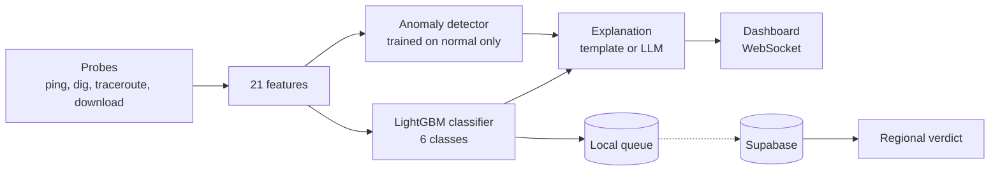
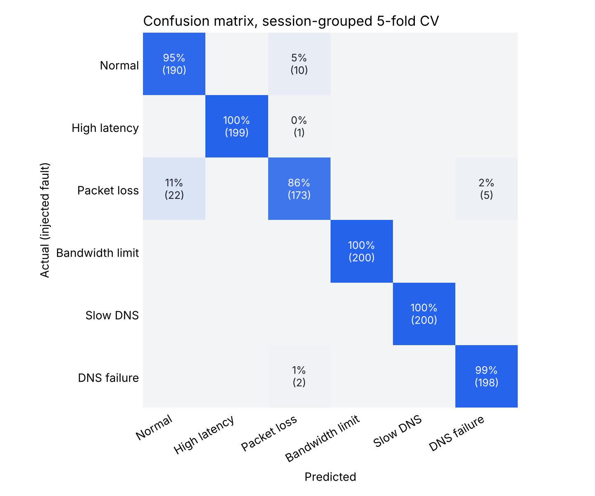
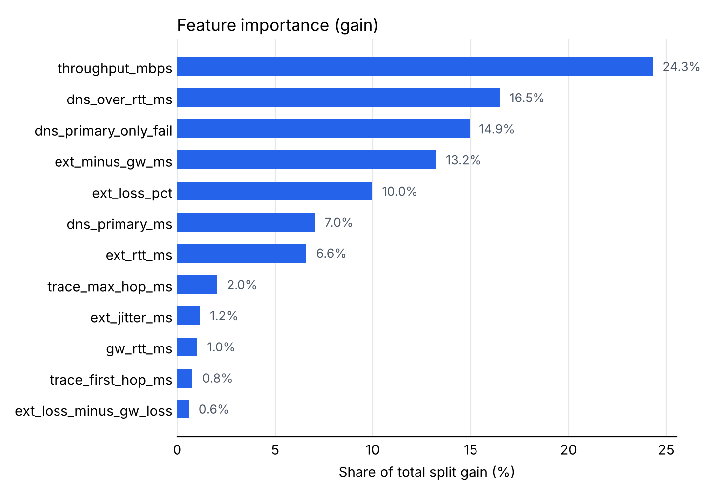

# Strata

**Strata digs through your network layer by layer to find what's broken.**

When the internet feels slow, the usual answer is "restart the router". Strata measures the path instead, classifies the root cause with a model trained on real injected faults, and explains the fix in plain language.

Built solo at MadHacks 2026 (theme: "Let's Dig In"). The name means layers of rock: the dashboard stacks the network path like strata and digs down until it hits the broken layer. `dig` is also the DNS lookup tool the collector runs on every measurement.

## How it works



1. **Measure.** Every round the collector pings the gateway and an external host, resolves names against two DNS servers, traces the route, and times a small download.
2. **Classify.** A LightGBM model turns the 21 features into a probability for each fault class. A separate anomaly detector, trained only on healthy measurements, flags behavior the classifier has never seen.
3. **Explain.** The verdict and the measurements that drove it become two or three sentences and a short list of fixes. Templates by default, or any OpenAI-compatible model.
4. **Show.** The dashboard digs down the layers (device, router, ISP, DNS, destination) and marks the broken one, next to live charts and the reasons behind the diagnosis.
5. **Aggregate.** Diagnoses are stored, and several agents in one region are compared to tell "my problem" from "regional outage".

The comparisons matter more than any single number. The gateway answers fast but the external host is slow: the problem is past your router. Pinging an IP works but names do not resolve: the problem is DNS.

## Results

Trained on 1,200 measurements collected while injecting real faults with `tc netem` on a Linux host. Evaluated with 5-fold cross-validation split by collection session, so rows from one fault session never appear in both train and test.

**Accuracy 96.7%, macro F1 0.966**

| Class | Precision | Recall | How it is injected |
|---|---|---|---|
| normal | 0.896 | 0.950 | nothing |
| high_latency | 1.000 | 0.995 | netem delay |
| packet_loss | 0.930 | 0.865 | netem loss |
| bandwidth_limit | 1.000 | 1.000 | netem rate |
| dns_slow | 1.000 | 1.000 | delay on port 53 replies only |
| dns_failure | 0.975 | 0.990 | resolver pointed at an unreachable address |

The anomaly detector flags 2.5% of healthy rows and 85 to 100% of faulty rows without ever seeing a fault during training.

| Confusion matrix | Feature importance |
|---|---|
|  |  |

The weak spot is light packet loss, which a handful of pings per round cannot always tell apart from a healthy link. See [Limitations](#limitations).

## Quick start (simulation mode)

Runs on any OS with no special permissions. Measurements and faults are simulated; the trained model, explanations, and dashboard are the real ones.

Requires Python 3.11+ and Node 18+.

```bash
git clone https://github.com/DARKXIGN/Strata.git
cd Strata

python3 -m venv .venv
.venv/bin/pip install -r requirements.txt     # Windows: .venv\Scripts\pip
cp .env.example .env                           # Windows: copy .env.example .env

.venv/bin/python -m uvicorn server.main:app --port 8000
```

In a second terminal:

```bash
cd web
npm install
npm run dev
```

Open http://localhost:5173, pick a fault in the panel, and watch the layers.

## Real mode (Linux, root)

Real faults are injected inside an isolated network namespace, never on the machine's main interface.

```bash
sudo apt install -y python3-venv iputils-ping dnsutils traceroute curl iproute2 iptables

sudo scripts/netns_up.sh                       # create the namespace and veth pair
sudo SIM_MODE=0 .venv/bin/python -m uvicorn server.main:app --port 8000
```

Inject from the dashboard or from the shell:

```bash
sudo scripts/fault.sh inject high_latency delay_ms=200 jitter_ms=20
sudo scripts/fault.sh inject packet_loss loss_pct=10
sudo scripts/fault.sh inject bandwidth_limit rate_kbit=1000
sudo scripts/fault.sh inject dns_slow delay_ms=800
sudo scripts/fault.sh inject dns_failure
sudo scripts/fault.sh reset
scripts/fault.sh status
```

Tear down when finished:

```bash
sudo scripts/netns_down.sh
```

If any requirement is missing (not Linux, not root, no `tc`, namespace not up), the server falls back to simulation mode and says why.

### Several agents on one host

Three namespaces act as three households in one region. Fault one and the regional card reports an individual issue; fault most of them and it reports a regional outage.

```bash
sudo scripts/netns_up.sh a b c

sudo SIM_MODE=0 STRATA_NETNS=strata-a .venv/bin/python -m uvicorn server.main:app --port 8000
sudo SIM_MODE=0 STRATA_NETNS=strata-b .venv/bin/python -m uvicorn server.main:app --port 8001
sudo SIM_MODE=0 STRATA_NETNS=strata-c .venv/bin/python -m uvicorn server.main:app --port 8002
```

The dashboard talks to the first server, which forwards fault requests for the other agents. Use the agent selector in the fault panel, or `sudo scripts/fault.sh --agent b inject packet_loss loss_pct=10`.

## Collect data and train your own model

The shipped model was trained on one host. To train on your own network:

```bash
# trial run: 5 rows per class, a few minutes
sudo .venv/bin/python -m scripts.collect run --rows-per-class 5 --session-rows 5 --out data/raw/trial.csv
.venv/bin/python -m scripts.collect summary data/raw/trial.csv

# full run: 200 rows per class, a few hours. Resumes if interrupted.
sudo .venv/bin/python -m scripts.collect run --rows-per-class 200 --out data/raw/main.csv

.venv/bin/python -m ml.train data/raw/main.csv
```

Each session uses one fault at one random severity, and every row records its session ID. Training writes the model, the anomaly detector, and the evaluation images to `models/`.

## Optional features

### LLM explanations

Explanations work offline from templates. To use a language model, open Settings in the dashboard or edit `.env`:

| Mode | What it uses |
|---|---|
| `template` (default) | Built-in sentences per fault. No network needed. |
| `local` | A local model through an OpenAI-compatible endpoint, for example Ollama at `http://localhost:11434/v1`. |
| `api` | Your own API key for any OpenAI-compatible provider. |

The model only writes the explanation. The classifier makes the diagnosis, and if the model call fails or takes longer than 3 seconds, Strata falls back to the template.

### Diagnosis history (Supabase)

1. Create a Supabase project and run `supabase/schema.sql` in the SQL editor.
2. Set `SUPABASE_URL` and `SUPABASE_SECRET_KEY` (an `sb_secret_...` key) in `.env`.
3. Check the connection: `.venv/bin/python -m storage.check --write`

Diagnoses go to a local SQLite queue first and upload in the background from the host network. If Supabase or the internet is down, live diagnosis keeps running and the queue drains later. Leave the variables empty to keep history local only.

## Safety design

Fault injection changes real network behavior, so the scripts are built to be boring:

- Faults apply only to the host end of the namespace's veth pair. The main interface is never shaped.
- DNS faults edit `/etc/netns/<name>/resolv.conf`, which only processes inside the namespace see. The host's resolver is untouched.
- Setup adds exactly three tagged firewall rules and teardown removes exactly those. Existing rules, Docker's chains, and saved firewall configuration are left alone.
- Faults reset on server start, on shutdown, on Ctrl+C, and on a dropped SSH session.
- API keys stay on the server, are masked in the UI, and never reach the frontend bundle or logs.

Every script lists what it changes and what it does not at the top of the file.

## Project structure

```
collector/   probes and parsers (ping, dig, traceroute, curl), plus a simulator
faults/      namespace fault injection and the simulated equivalent
ml/          features, training, classifier, anomaly detector
explain/     template and LLM explanations with fallback
storage/     local queue, Supabase upload, regional aggregation
server/      FastAPI app, WebSocket stream, multi-agent control
web/         React + TypeScript dashboard
scripts/     namespace setup and teardown, fault CLI, data collection
supabase/    database schema
models/      trained model, anomaly detector, evaluation report and images
tests/       parser fixtures and unit tests
```

Run the tests with:

```bash
.venv/bin/python -m unittest discover -s tests -t .
```

## Limitations

- **Trained on one network.** The data comes from a single cloud host on a wired data-center link. Home Wi-Fi has different baselines, so the model should be retrained (or at least recalibrated) before use elsewhere. The collection script makes that a few hours of unattended work.
- **No Wi-Fi layer.** The test host has no wireless interface, so weak signal is not a class. The Wi-Fi layer in the dashboard is shown but not diagnosed.
- **Light packet loss is hard.** Recall for packet loss is 86.5%. At low loss rates a few pings per round often lose nothing, and the round looks healthy.
- **One fault at a time.** The classifier picks a single cause. Combined faults were not collected.
- **Regions are simulated.** The regional verdict is demonstrated with three namespaces on one host, not with agents in separate homes.

## What's next

- Agents on real home networks reporting to one backend, so an ISP can see a regional outage before the calls start
- A Wi-Fi class and combined faults
- More probes per round for a sharper packet-loss signal

## Credits

- Font: [Pretendard](https://github.com/orioncactus/pretendard)
- Icons: [Fluent Emoji](https://github.com/microsoft/fluentui-emoji) by Microsoft, MIT License, used unmodified
- Built by Brian Kwon ([DARKXIGN](https://github.com/DARKXIGN))
